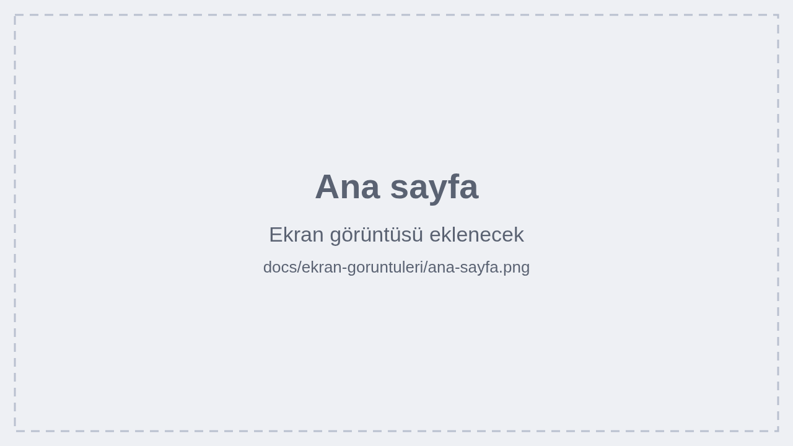
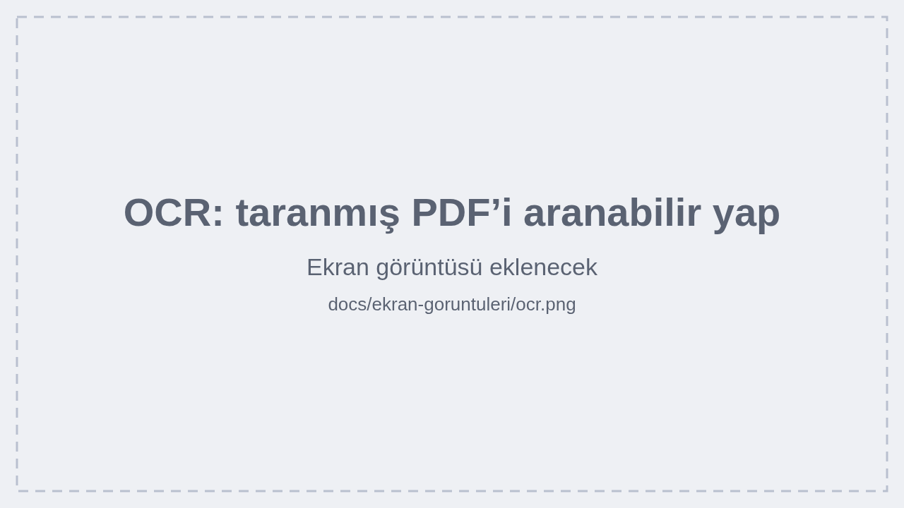
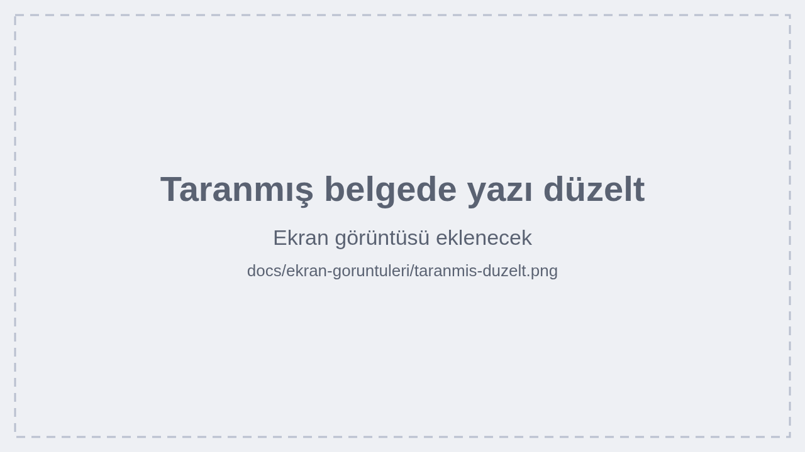
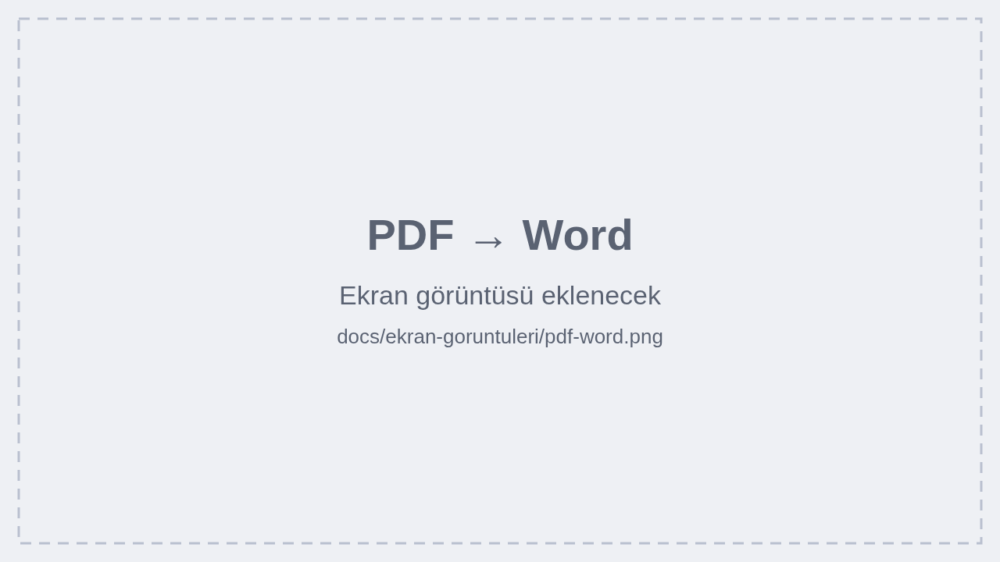
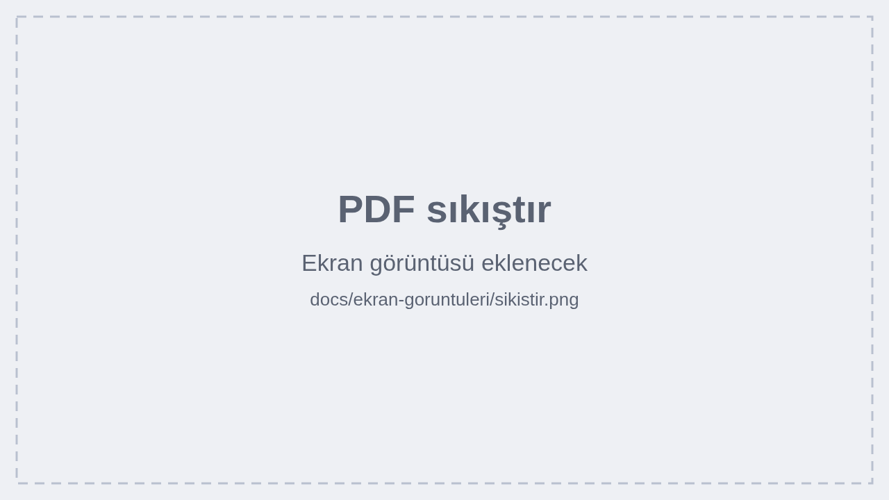
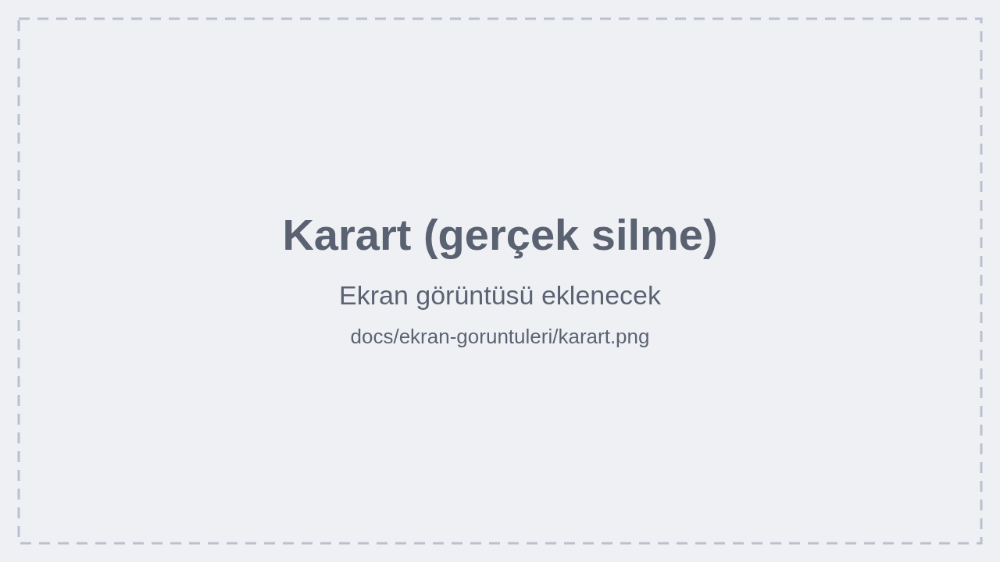
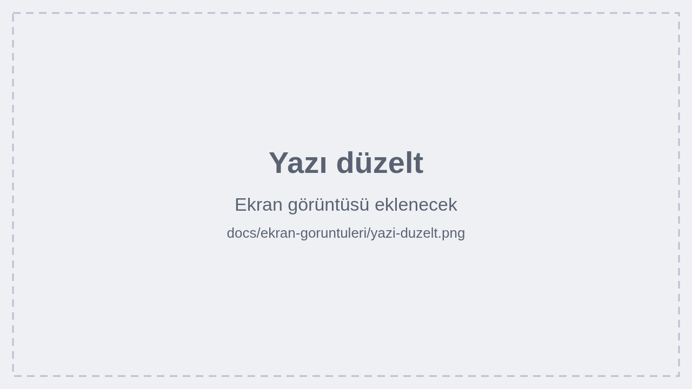

# PDF Tools (PDF Araçları)

[Türkçe](README.md) · **English**

A browser-based, **serverless**, open-source (MIT) set of **PDF and Excel** tools. The home page has two big buttons: **PDF editing** and **Excel editing**. The interface is in **Turkish**, with full Turkish-character support and Turkish OCR.
**Your files never leave your device:** no uploads, no accounts, no tracking, no external services (OCR included — everything is served from the site itself). It works well on phones too.

> 🔗 Live site: `https://YOUR_USERNAME.github.io/pdf-araclari/` (update this after publishing)

## What can it do?

| Group | Tools |
|---|---|
| Edit pages | Merge · Split · Delete pages · Reorder · Rotate · Extract pages · Crop · **Fix text** (text-based PDFs; page layout stays identical) · **Fix text in scanned documents** (only in the region you select) |
| Improve | **OCR** (read a scanned PDF in Turkish and make it searchable) · **Compress PDF** (quality-preserving) · **Repair PDF** (tries to recover damaged/truncated files) |
| Convert to PDF | **Word → PDF** · **PowerPoint → PDF** · **Excel → PDF** · **HTML → PDF** · Images to PDF · **Scan to PDF** (camera/gallery photos → clean scan) |
| Convert from PDF | PDF → Word · **PDF → Markdown** (no page/file limit) · **PDF → Excel** · **PDF → PowerPoint** · PDF to images (PNG/JPEG, ZIP) · **Extract embedded images** · **PDF → PDF/A (experimental)** |
| Add to a document | Page numbers · Header/footer · Add watermark (and remove **only the ones this site added**) · Visible signature / text box · **Shapes & highlighter** · Fill forms · **Create fillable forms** |
| Excel | **Merge Excel files** (order kept, top rows to skip are adjustable) · **Patient application analysis** (auto-detects ID / name / application-no columns, counts people, shows cross-file presence, exports to Excel) |
| Security & compare | **Redact (true removal)** — text is erased from the picture *and* from the file · Add password (AES-256) · Remove password (**only if you know it**) · **Compare PDFs** (text and visual differences) |

**There is no page or file limit:** every tool processes as many pages as you give it (tests cover e.g. a 3000-paragraph HTML, a 5000-row spreadsheet, a 300-slide deck); only your device's memory is the limit.

**Batch processing:** every tool that takes a single file (compress, OCR, PDF → Word/Markdown/Excel/PowerPoint, Word/Excel/PowerPoint → PDF, redact, add/remove password, watermark, page numbers…) accepts **as many files as you like** (or a whole **folder**) at once. Files are processed one after another with the same settings; each gets its own output and everything downloads as ZIP files. A failing file is skipped (the reason is listed) and the rest continue; the run can be cancelled. In testing, 500 PDFs were loaded and converted in one go (about 3 minutes; it depends on file contents). Tools that already take several files (merge, compare, images to PDF, scan) don't need it; tools where you pick pages/regions (fix text, fix scanned text, add shapes, create/fill forms, reorder pages) have no batch mode.

## Screenshots

> The images below are **placeholders** for now. Take real screenshots and save them with the **same file names** in `docs/ekran-goruntuleri/`
> (how-to: [docs/ekran-goruntuleri/README.md](docs/ekran-goruntuleri/README.md)).

| | |
|---|---|
|  |  |
|  |  |
|  |  |
|  | |

## Principles

- There is **no** feature to crack or guess unknown PDF passwords. Password removal only works when the user types the password.
- There is **no** general tool to strip someone else's watermark or copyright mark. Only watermarks added by this site can be undone.
- Edited documents are not made to look like "untouched originals": the producer and modification date are written honestly.
- When unsure, nothing is silently broken: features that may be affected (forms, bookmarks, digital signatures…) are shown as **warnings** on the result screen.
- **Text read by OCR is never written into the visible document automatically.** OCR only adds an invisible, searchable layer; changing text in a scanned document is done only in regions you select and with text you type.
- Nothing is reported as "working" without an automated test (see below).

## Known limitations

No PDF tool works perfectly on every document. The limitations we know of:

**General**
- Everything runs in your browser, so very large files (roughly 150 MB+) and low-memory phones may struggle; the page can freeze briefly during heavy operations.
- Automated tests run on Node.js; manual testing was done only in a Chromium-based browser (desktop + 375 px phone width). **Safari, Firefox and real phones have not been tested.**
- Any change to a digitally signed document invalidates the signature; the output is a new unsigned file (a warning is shown).
- Operations such as delete/extract/split copy pages into a new document; form fields, bookmarks and attachments may not carry over (a warning is shown).

**PDF → Markdown / Excel / PowerPoint**
- Structure (headings, paragraphs, tables, columns) is **guessed** from the PDF; two-column pages are read left → right, merged-cell/nested tables, formulas and text boxes may break. Markdown keeps http/https/mailto links, not internal links.
- PDF → Excel finds tables only from text alignment (ruling lines are not read) and warns if none is found. PDF → PowerPoint substitutes similar fonts (Arial, Times New Roman, Calibri…); scanned pages become image-only slides.

**Word / PowerPoint / Excel / HTML → PDF**
- These are **not** Word, PowerPoint or a browser: appearance and page breaks will not be identical. Word: no headers/footers, footnotes, text boxes, shapes, equations or column sections; PowerPoint: no animations, SmartArt, charts, gradients or rotated objects (shapes are drawn as rectangles); Excel: no colours/borders/charts, values only as a table; HTML: no CSS, JavaScript, external images/styles or fetching by URL. Legacy .doc / .ppt are not supported. Unsupported items are listed in the result.

**Repair PDF**
- Damaged cross-reference tables and truncated file endings are recovered; if most of the file is missing (page data, fonts) recovery is impossible and this is stated clearly. The result is rendered and checked.

**Scan to PDF / Compare / shapes & forms**
- Scanning: no automatic page-edge detection or perspective correction; the black-and-white mode ruins photos. Compare: text diff relies on selectable text, visual diff on pixels; very long pages are limited to the first 3000 words for the word diff. Shapes land correctly on rotated pages; use the signature pad for freehand drawing. Form creation has no JavaScript validation/formatting or digital-signature fields.

**PDF → PDF/A (EXPERIMENTAL)**
- The output approaches PDF/A-2b but has **not** been validated with an official validator (veraPDF); conformance is not guaranteed. Pages are rasterised (file grows, fonts/vectors are lost; text is kept as a searchable layer).

**In iLovePDF but NOT here:** AI summarising and translation (they require sending the file to an AI service, which breaks this site's "files never leave your device" principle), requesting e-signatures from others, workflows, desktop/mobile apps and account/subscription features.

**Excel**
- Only the **first sheet** of each file is read. In the analysis the header row is found within the first 15 rows by an "ID"/"name" header; unrecognised headers produce a per-file warning.
- Reading uses SheetJS `xlsx` 0.18.5 (the latest on npm). That version has known issues with maliciously crafted spreadsheets; only open **your own, trusted** files. Files never leave your device.
- Merging aligns columns side by side; files with differently ordered headers get a warning but are not fixed. All cells are written as text (leading zeros are kept).

**OCR (making scanned documents searchable)**
- Only the **Turkish** model is bundled (English words are usually read but with more errors). Handwriting, blurry, faint, skewed or low-resolution scans give poor results; page orientation/skew is not auto-corrected.
- OCR can make mistakes, which is why its output is added only as an **invisible search layer**. A misread word may not be found by search.
- Takes roughly 3–10 seconds per page (longer on phones). About 6 MB of OCR files (engine + Turkish data) are loaded from the site itself on first use.

**Fixing text in scanned documents**
- Only the **region you select** changes; the whole page is never rewritten automatically. To go page by page, click OCR lines and fix them one by one.
- The region is covered with a **flat background colour** estimated from its surroundings. On patterned, gradient or stained backgrounds the patch may be visible.
- New text is drawn with an open-licensed font and will look different from the original print/handwriting. Do not use it to pass a document off as an "untouched scan".
- In **cover mode the old image stays in the file** (it is only covered). Use the "permanent" option for files you will share: the page is re-rasterised (quality limited by the chosen dpi).

**Fix text (text-based PDFs)**
- For fonts without a metric-compatible open substitute, lines are left as in the original (listed as "needs checking" in the report). Type3, vertical and invisible/clipped text is protected.
- Kerning is not applied to new text; the accessibility text of tagged PDFs may stay old.

**PDF → Word**
- PDF places text on the page piece by piece; Word flows text. **The result will not be identical to the original.** Paragraphs, headings (from font size), bullet points, images and neatly aligned simple tables are guessed.
- Two-column pages are read left → right (the guess can be wrong). Merged-cell/nested tables, text boxes, formulas, footnote placement and special fonts may break. Ruling lines are not detected.
- Words hyphenated at a line end are joined (a genuinely hyphenated word could be affected). Scanned pages may contain OCR errors; font/weight and that page's images are not carried over.

**Compress PDF**
- Only photo-like images (JPEG and multi-colour Flate) are shrunk. Images with transparency masks, CMYK, 1-bit/black-and-white scans (CCITT/JBIG2) and graphics are left untouched; gains can be small for B/W scans or text-only documents.
- Re-encoded images assume sRGB (ICC profiles are not kept). If there is no gain, the original file is returned as is.

**Redact (true removal)**
- Redacted pages are rasterised (the file can grow; on those pages text stays searchable only through a layer for the remaining text). Bookmarks, attachments, form fields and document info are not carried over.
- Search-based redaction **estimates** word boxes from text positions; in the middle of long lines it may also cover a letter or two extra, or fall slightly short. Words hyphenated across lines may not be found. **Always check the result visually**, and for critical documents also open it in another reader.
- In scanned documents the search relies on OCR; a word OCR misreads cannot be found — draw the box by hand.

## Run it on your computer (development server)

1. Install [Node.js](https://nodejs.org) (LTS).
2. In this folder, open a terminal and run:

```powershell
npm install
npm run dev
```

3. Open the address printed on screen (usually `http://localhost:5173`).

To try the production build:

```powershell
npm run build
npm run preview
```

## Tests

```powershell
npm test
```

Every tool is tested by **rendering pages and comparing pixel by pixel** (e.g. "add watermark → undo" must return the original page exactly).
There are also tests for OCR, Word export, compression and redaction — the redaction test checks that the removed text is **nowhere** in the file (raw bytes, decoded streams, document info).

To try your own PDFs:

```powershell
npm run ornek-test                         # default: the "ornekler" folder on the Desktop
npm run ornek-test -- "D:\other\folder"    # another folder
```

The report is written to `ciktilar/ornek-test/rapor.md`. This folder is **not** committed, so personal documents never enter the repository.

## Publishing on GitHub Pages

1. Create a new **empty** repository on GitHub (e.g. `pdf-araclari`).
2. In this folder:

```powershell
git remote add origin https://github.com/YOUR_USERNAME/pdf-araclari.git
git branch -M main
git push -u origin main
```

3. In the repository: **Settings → Pages → Build and deployment → Source: "GitHub Actions"**.
4. On every push to `main`, `.github/workflows/yayin.yml` runs the tests, builds the site and publishes it.
   Address: `https://YOUR_USERNAME.github.io/pdf-araclari/`

(The site uses relative paths, so it also works in a sub-folder.) A very simple step-by-step guide (in Turkish): [docs/GITHUB_YAYIN.md](docs/GITHUB_YAYIN.md).

## Project layout

```
index.html, <tool>.html   Home page and one page per tool (generated by npm run sayfalar)
src/core/                 PDF core (same code in the browser and Node; tests target this)
src/core/yazi/            Text-fixing engine (text-based PDFs)
src/ui/, src/sayfalar/    UI and each tool's page script
src/araclar.js            The single list of tools (menu, home page and page generator use it)
public/fonts/             Fonts + licence files
public/tesseract/         OCR files (copied automatically at build; not committed)
docs/                     Screenshot placeholders, publishing guide
tests/                    Automated tests
tools/                    Page generator, sample-PDF test, rendering comparison helpers
PROJE_NOTLARI.md          Project plan, rules, stage list (Turkish)
```

## Open-source components

pdf.js (Apache-2.0), pdf-lib (MIT), qpdf WebAssembly (Apache-2.0), tesseract.js + Turkish language data (Apache-2.0), docx (MIT), fonts (SIL OFL 1.1) and others.
Details: [THIRD_PARTY_LICENSES.md](THIRD_PARTY_LICENSES.md).

## Licence

[MIT](LICENSE)
