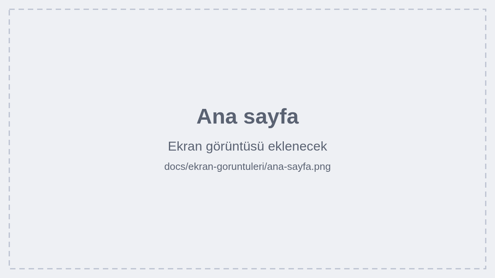
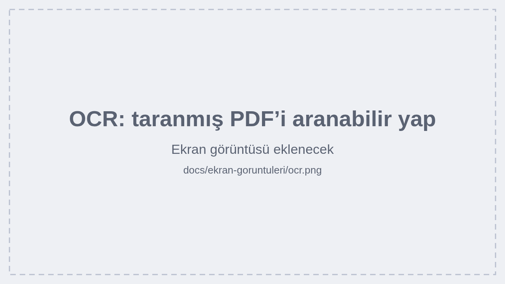
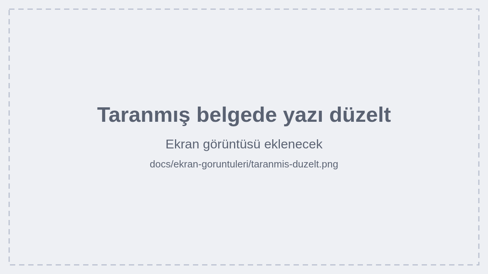
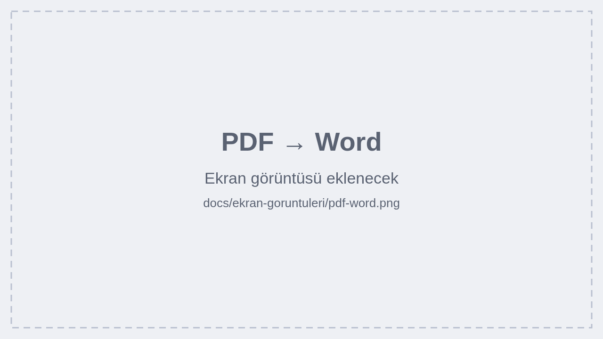
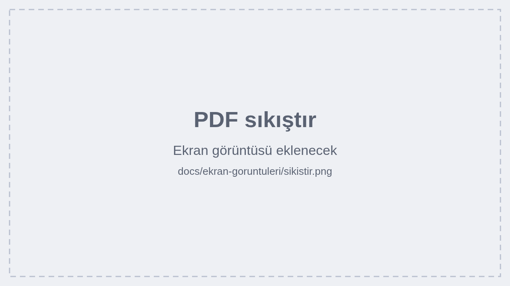
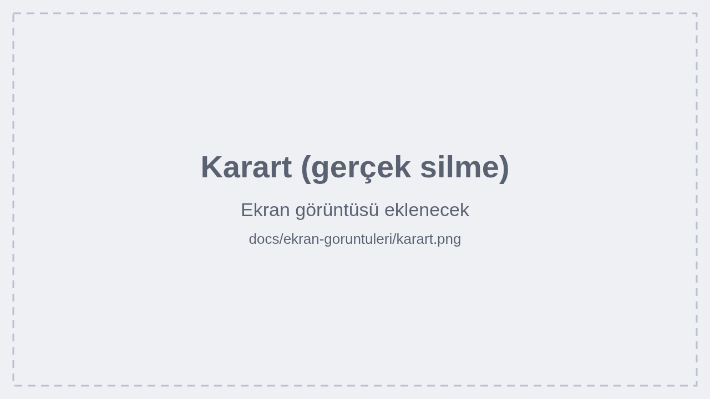
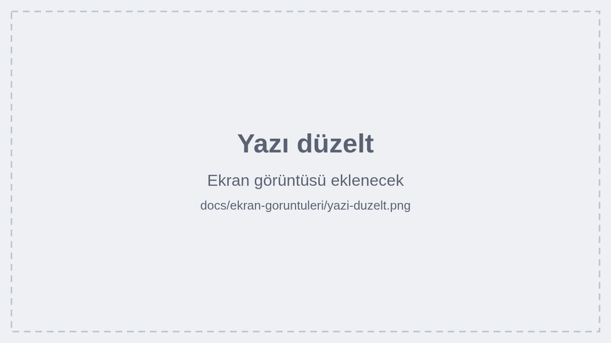

# PDF Araçları

**Türkçe** · [English](README.en.md)

Tarayıcıda çalışan, **sunucusuz**, açık kaynaklı (MIT) bir **PDF ve Excel** araçları sitesi. Ana sayfada iki büyük düğme vardır: **PDF düzenleme** ve **Excel düzenleme**.
**Dosyalarınız cihazınızdan asla çıkmaz:** yükleme yok, hesap yok, izleme yok, dış servis yok (OCR dahil her şey sitenin kendi dosyalarıyla çalışır). Telefonda da rahat kullanılır, arayüz Türkçedir.

> 🔗 Canlı site: `https://KULLANICI_ADINIZ.github.io/pdf-araclari/` (yayınladıktan sonra burayı güncelleyin)

## Neler yapabilir?

| Grup | Araçlar |
|---|---|
| Sayfaları düzenle | PDF birleştir · PDF böl · Sayfa sil · Sayfa sırala · Sayfa döndür · Sayfa çıkar · Kırp · **Yazı düzelt** (metin tabanlı PDF; sayfa düzeni aynen kalır) · **Taranmış belgede yazı düzelt** (yalnızca seçtiğiniz bölge) |
| İyileştir | **OCR** (taranmış PDF'i Türkçe okuyup aranabilir yapma) · **PDF sıkıştır** (kaliteyi koruyarak) · **PDF onar** (bozuk/yarım PDF'i kurtarmayı dener) |
| PDF'e dönüştür | **Word → PDF** · **PowerPoint → PDF** · **Excel → PDF** · **HTML → PDF** · Resimden PDF · **PDF'e tara** (kamera/galeri fotoğraflarını temiz taramaya çevirir) |
| PDF'ten dönüştür | PDF → Word · **PDF → Markdown** (sayfa/dosya sınırı yok) · **PDF → Excel** · **PDF → PowerPoint** · PDF → resim (PNG/JPEG, ZIP) · **PDF'teki resimleri ayıkla** · **PDF → PDF/A (deneysel)** |
| Belgeye ekle | Sayfa numarası · Üst/alt bilgi · Filigran ekle (ve **kendi eklediğini** geri al) · Görünür imza / metin kutusu · **Şekil ve vurgu ekle** · Form doldur · **Doldurulabilir form oluştur** |
| Excel | **Excel birleştir** (sıra korunur, atlanacak üst satırlar ayarlanır) · **Hasta başvuru analizi** (TC / ad soyad / başvuru no sütunlarını otomatik bulur, kişileri sayar, dosyalar arası çapraz varlığı gösterir, Excel'e aktarır) |
| Güvenlik ve karşılaştırma | **Karart (gerçek silme)** — yazı hem görüntüden hem dosyadan silinir · Şifre ekle (AES-256) · Şifre kaldır (**yalnızca şifre biliniyorsa**) · **PDF karşılaştır** (iki sürümün yazı ve görüntü farkı) |

**Sayfa ve dosya sınırı yoktur:** tüm araçlar istediğiniz kadar sayfayı işler (örneğin 3000 paragraflık HTML, 5000 satırlık Excel, 300 slaytlık sunum testlerle denendi); yalnızca cihazınızın belleği sınırdır.

Türkçe karakterler (ğ ş ı İ ö ü ç) tüm araçlarda sorunsuz çalışır: açık lisanslı, ölçü uyumlu yazı tipleri
(Liberation, Carlito, Caladea, Noto) ve Türkçe OCR dil verisi projeye dahildir.

## Ekran görüntüleri

> Aşağıdaki görseller şimdilik **yer tutucudur**. Gerçek ekran görüntüsü alıp `docs/ekran-goruntuleri/` klasöründe **aynı adla** üzerine kaydedin
> (nasıl alınacağı: [docs/ekran-goruntuleri/README.md](docs/ekran-goruntuleri/README.md)).

| | |
|---|---|
|  |  |
|  |  |
|  |  |
|  | |

## İlkeler

- Bilinmeyen PDF şifresini kırma / deneme-yanılma özelliği **yoktur**. Şifre kaldırma yalnızca kullanıcı şifreyi girerse çalışır.
- Başkasının koyduğu filigranı ya da telif işaretini silen genel bir araç **yoktur**. Yalnızca bu sitenin eklediği filigran geri alınabilir.
- Düzenlenen belgenin "değiştirilmemiş orijinal" gibi görünmesi için iz saklanmaz; üretici ve değişiklik tarihi dürüstçe yazılır.
- Emin olunmayan durumda sessizce bozulmaz: belgenin etkilenebilecek özellikleri (form, yer imi, dijital imza…) sonuç ekranında **uyarı** olarak gösterilir.
- **Programın okuduğu (OCR) yazı belgeye kendiliğinden yazılmaz.** OCR yalnızca görünmez, aranabilir bir katman ekler; taranmış belgede yazı değiştirmek yalnızca sizin seçtiğiniz bölgede ve sizin yazdığınız metinle yapılır.
- Hiçbir şey "çalıştı" diye bildirilmez; her araç için otomatik test vardır (aşağıya bakın).

## Bilinen sınırlar

Hiçbir PDF aracı her belgede kusursuz çalışmaz. Bu sitenin bildiği sınırlar:

**Genel**
- Her şey tarayıcınızda çalıştığı için çok büyük dosyalar (yaklaşık 150 MB üstü) ve düşük bellekli telefonlar sorun çıkarabilir; ağır işlemlerde arayüz kısa süre donabilir.
- Otomatik testler Node.js'te, elle deneme ise yalnızca Chromium tabanlı bir tarayıcıda (masaüstü + 375 px telefon genişliği) yapıldı. Safari, Firefox ve gerçek telefonlarda denenmedi.
- Dijital imzalı belgede yapılan her değişiklik imzayı geçersiz kılar; çıktı imzasız yeni bir dosyadır (uyarı gösterilir).
- Sayfa silme/çıkarma/bölme gibi işlemler sayfaları yeni belgeye kopyalar; form alanları, yer imleri ve ekler taşınmayabilir (uyarı gösterilir).

**PDF → Markdown / Excel / PowerPoint**
- Yapı (başlık, paragraf, tablo, sütun) PDF'ten **tahmin edilir**; iki sütunlu sayfalar sol → sağ sıralanır, birleştirilmiş hücreli/iç içe tablolar, formüller ve metin kutuları bozulabilir. Markdown'da bağlantılar (http/https/mailto) korunur, sayfa içi bağlantılar korunmaz.
- PDF → Excel yalnızca yazıların hizasından tablo bulur (çizgiler okunmaz); tablo yoksa uyarır. PDF → PowerPoint'te yazı tipleri benzerleriyle değişir (Arial, Times New Roman, Calibri…), taranmış sayfalar yalnızca resim olur.

**Word / PowerPoint / Excel / HTML → PDF**
- Bunlar Word, PowerPoint ya da tarayıcı **değildir**: görünüm/sayfa sonları birebir aynı olmaz. Word: üst/alt bilgi, dipnot, metin kutusu, şekil, denklem ve sütunlu bölümler yok; PowerPoint: animasyon, SmartArt, grafik, gradyan, döndürülmüş nesne yok, şekiller dikdörtgen çizilir; Excel: renk/kenarlık/grafik yok, yalnızca değerler tablo olarak yazılır; HTML: CSS, JavaScript, harici resim/stil ve adresten (URL) çevirme yok. Eski .doc / .ppt desteklenmez. Sonuçta desteklenmeyen öğeler ayrıca bildirilir.

**PDF onar**
- Çapraz başvuru tablosu/başlık hasarı ve sonu kesilmiş dosyalar kurtarılır; dosyanın büyük kısmı eksikse (sayfa verileri, yazı tipleri yok) kurtarma yapılamaz ve bu açıkça söylenir. Sonuç çizilerek denetlenir.

**PDF'e tara / PDF karşılaştır / şekil ve form araçları**
- Tarama: belge kenarını otomatik bulma ve perspektif düzeltme yoktur; siyah-beyaz kip fotoğrafı bozar. Karşılaştırma: metin farkı seçilebilir yazıya, görsel fark piksellere dayanır; çok uzun sayfalarda sözcük karşılaştırması ilk 3000 sözcükle sınırlıdır. Şekiller dönük sayfalarda doğru yere gelir; serbest çizim için imza tahtası kullanılır. Form oluştururken JavaScript'li doğrulama/biçimlendirme ve dijital imza alanı yoktur.

**PDF → PDF/A (DENEYSEL)**
- Çıktı PDF/A-2b'ye yaklaşır ama resmî bir doğrulayıcıyla (veraPDF) **sınanmamıştır**; uyumlu olduğu garanti edilmez. Sayfalar resme çevrilir (dosya büyür, yazı tipleri/vektörler kalmaz; yazı aranabilir katman olarak korunur).

**iLovePDF'te olup burada OLMAYANLAR:** yapay zekâ ile özet ve çeviri (internete/yapay zekâ hizmetine gönderme gerektirir; bu sitenin "dosya cihazdan çıkmaz" ilkesine aykırıdır), başkalarından e-imza isteme, iş akışları, masaüstü/mobil uygulama ve hesap/abonelik özellikleri.

**Excel**
- Her dosyanın yalnızca **ilk sayfası** okunur. Analizde başlık satırı ilk 15 satır içinde "TC" ya da "ad soyad" başlığından bulunur; başlıklar tanınmazsa dosya için uyarı verilir.
- Okuma için SheetJS `xlsx` 0.18.5 kullanılır (npm'deki son sürüm). Bu sürümde, özel hazırlanmış zararlı bir Excel dosyasını açarken sorun çıkarabilecek bilinen açıklar vardır; yalnızca **kendi, güvendiğiniz** dosyalarınızı açın. Dosyalar cihazınızdan çıkmaz.
- Birleştirmede sütunlar yan yana hizalanır; başlıkları farklı sıradaki dosyalar için uyarı verilir ama düzeltilmez. Tüm hücreler metin olarak yazılır (baştaki sıfırlar korunur).

**OCR (taranmış belgeyi aranabilir yapma)**
- Yalnızca **Türkçe** model bulunur (İngilizce sözcükler genellikle okunur ama hata artar). El yazısı, bulanık, soluk, eğik ya da düşük çözünürlüklü taramalarda sonuç zayıftır; sayfa yönü/eğimi otomatik düzeltilmez.
- OCR hata yapabilir; bu yüzden yalnızca **görünmez arama katmanı** olarak eklenir. Yanlış okunan kelime aramada çıkmayabilir.
- Sayfa başına yaklaşık 3–10 saniye sürer (telefonda daha uzun). İlk kullanımda yaklaşık 6 MB'lık OCR dosyaları (motor + Türkçe dil verisi) sitenin kendisinden yüklenir.

**Taranmış belgede yazı düzeltme**
- Yalnızca **seçtiğiniz bölge** değişir; tüm sayfa otomatik yeniden yazılmaz. Sayfa sayfa gitmek isterseniz OCR satırlarına tıklayıp tek tek düzeltirsiniz.
- Bölge, çevresinden tahmin edilen **düz bir zemin rengiyle** örtülür. Desenli, degrade ya da lekeli zeminde örtü fark edilebilir.
- Yeni yazı, açık lisanslı bir yazı tipiyle yazılır; özgün baskı/el yazısından farklı görünür. Belgeyi "değiştirilmemiş tarama" gibi göstermek için kullanmayın.
- **Örtme kipinde eski görüntü dosyada durur** (yalnızca üstü kapanır). Paylaşacağınız dosyalarda “kalıcı” seçeneğini kullanın: sayfa yeniden resimlenir (kalite seçilen dpi ile sınırlı olur).

**Yazı düzelt (metin tabanlı PDF)**
- Ölçü uyumlu açık karşılığı olmayan yazı tiplerinde satırlar orijinal kalır (rapora “kontrol gerekli” olarak yazılır). Type3, dikey, görünmez/kırpma yazıları korunur.
- Yeni yazıda ikili harf aralığı (kerning) uygulanmaz; etiketli PDF'te erişilebilirlik metni eski kalabilir.

**PDF → Word**
- PDF'te yazılar sayfaya tek tek yerleştirilmiştir, Word'de metin akar: **sonuç orijinalin birebir aynısı olmaz.** Paragraf, başlık (yazı boyutundan), madde işareti, resim ve hizalı basit tablolar tahmin edilir.
- İki sütunlu sayfalar sol → sağ sıralanır (yanlış tahmin edebilir). Birleştirilmiş hücreli/iç içe tablolar, metin kutuları, formüller, dipnot yerleşimi ve özel yazı tipleri bozulabilir. Çizgiler algılanmaz.
- Satır sonundaki tireyle bölünmüş sözcükler birleştirilir (gerçek tireli bir sözcük etkilenebilir). Taranmış sayfalarda OCR hataları olabilir; yazı tipi/kalınlık ve o sayfadaki resimler aktarılmaz.

**PDF sıkıştır**
- Yalnızca fotoğraf türü (JPEG ve çok renkli Flate) resimler küçültülür. Saydamlık maskeli, CMYK, 1 bit/siyah-beyaz tarama (CCITT/JBIG2) ve grafik resimlere dokunulmaz; bu yüzden siyah-beyaz taramalarda ya da yalnızca yazıdan oluşan belgelerde kazanç az olabilir.
- Renk profilleri (ICC) yeniden kodlanan resimlerde sRGB varsayılır. Kazanç yoksa özgün dosya olduğu gibi verilir.

**Karart (gerçek silme)**
- Karartılan sayfalar resme dönüştürülür (dosya büyüyebilir; o sayfalarda yazı seçimi, yalnızca kalan yazı için aranabilir katmanla sağlanır). Yer imleri, ekler, form alanları ve belge bilgileri yeni dosyaya taşınmaz.
- Metne göre bulma, kelime kutularını yazı konumundan **tahmin eder**; uzun satırların ortasındaki kelimelerde fazladan bir iki harf de karartılabilir ya da kutu kısa kalabilir. Satır sonunda tireyle bölünmüş sözcükler bulunamayabilir. **Sonucu mutlaka gözle kontrol edin**, çok önemli belgelerde başka bir okuyucuyla da deneyin.
- Taranmış belgede arama OCR'a bağlıdır; OCR'ın yanlış okuduğu sözcük bulunamaz — kutuyu elle çizin.

## Bilgisayarınızda açmak (geliştirme sunucusu)

1. [Node.js](https://nodejs.org) (LTS sürümü) kurulu olmalı.
2. Bu klasörde bir terminal (PowerShell) açın ve sırayla çalıştırın:

```powershell
npm install
npm run dev
```

3. Ekrana yazılan adresi (genellikle `http://localhost:5173`) tarayıcıda açın.

Yayın sürümünü (GitHub'a yüklenecek haliyle) denemek için:

```powershell
npm run build
npm run preview
```

## Testler

```powershell
npm test
```

Her araç için, sayfaları **çizip piksel piksel karşılaştıran** testler çalışır (ör. "filigran ekle → geri al" sonrası sayfa özgünüyle birebir aynı olmalı).
OCR, Word, sıkıştırma ve karartma için de testler vardır; örneğin karartma testi, silinen metnin dosyanın **hiçbir yerinde** (ham bayt, açılmış akışlar, belge bilgileri) kalmadığını denetler.

Kendi PDF'lerinizle (gerçek belgelerle) deneme yapmak için:

```powershell
npm run ornek-test                         # varsayılan: Masaüstündeki "ornekler" klasörü
npm run ornek-test -- "D:\baska\klasor"    # başka bir klasör
```

Rapor `ciktilar/ornek-test/rapor.md` dosyasına yazılır. Bu klasör git'e **eklenmez**; kişisel belgeleriniz depoya girmez.

## GitHub Pages'te yayınlamak

1. GitHub'da yeni bir **boş** depo oluşturun (ör. `pdf-araclari`).
2. Bu klasörde:

```powershell
git remote add origin https://github.com/KULLANICI_ADINIZ/pdf-araclari.git
git branch -M main
git push -u origin main
```

3. GitHub'da depo sayfasında **Settings → Pages → Build and deployment → Source: "GitHub Actions"** seçin.
4. `main` dalına her gönderimde `.github/workflows/yayin.yml` testleri çalıştırır, siteyi derler ve yayınlar.
   Adres: `https://KULLANICI_ADINIZ.github.io/pdf-araclari/`

(Site göreli yollar kullandığı için alt klasörde de sorunsuz çalışır.) Adım adım, resimsiz ve çok basit anlatım: [docs/GITHUB_YAYIN.md](docs/GITHUB_YAYIN.md).

## Proje yapısı

```
index.html, <arac>.html   Ana sayfa ve her araç için ayrı sayfa (npm run sayfalar ile üretilir)
src/core/                 PDF çekirdeği (tarayıcıda ve Node'da aynı kod; testler buradan)
src/core/yazi/            Yazı düzeltme motoru (metin tabanlı PDF)
src/ui/, src/sayfalar/    Arayüz ve her aracın sayfa betiği
src/araclar.js            Tüm araçların listesi (menü, ana sayfa ve sayfa üretici bunu kullanır)
public/fonts/             Yazı tipleri + lisans dosyaları
public/tesseract/         OCR dosyaları (derlemede otomatik kopyalanır; git'e eklenmez)
docs/                     Ekran görüntüleri için yer, yayın rehberi
tests/                    Otomatik testler
tools/                    Sayfa üretici, örnek PDF testi, çizim karşılaştırma yardımcıları
PROJE_NOTLARI.md          Proje planı, kurallar, aşama listesi
```

## Kullanılan açık kaynak bileşenler

pdf.js (Apache-2.0), pdf-lib (MIT), qpdf WebAssembly (Apache-2.0), tesseract.js + Türkçe dil verisi (Apache-2.0), docx (MIT), yazı tipleri (SIL OFL 1.1) ve diğerleri.
Ayrıntılar: [THIRD_PARTY_LICENSES.md](THIRD_PARTY_LICENSES.md).

## Lisans

[MIT](LICENSE)
